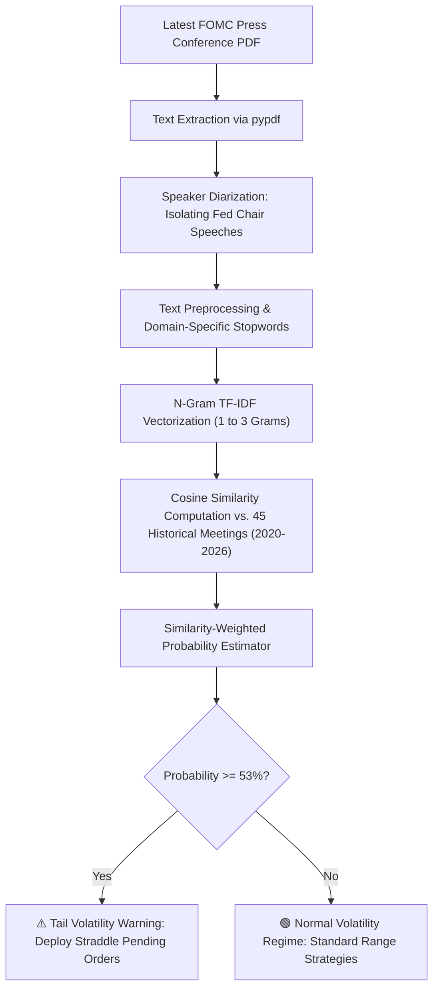

# 🏛️ FOMC NLP Tail Volatility Forecasting: XAU/USD (Gold)

[](https://www.python.org/downloads/)
[](https://opensource.org/licenses/MIT)
[](https://finance.yahoo.com/quote/GC%3DF)
[]()
[]()

> **Institutional quantitative NLP framework predicting tail volatility risk (≥ 400 pips / $40.00 USD) in Gold (XAU/USD) from Federal Open Market Committee (FOMC) press conference transcripts using N-Gram TF-IDF and Cosine Similarity.**

---

## 📌 Table Of Contents
- [1. Quantitative Background & Empirical Thesis](#1-quantitative-background--empirical-thesis)
- [2. System Architecture & Analytical Pipeline](#2-system-architecture--analytical-pipeline)
- [3. Formal Statistical Validation Results](#3-formal-statistical-validation-results)
- [4. Project Directory Structure](#4-project-directory-structure)
- [5. Installation Guide](#5-installation-guide)
- [6. Application Execution Guide](#6-application-execution-guide)
- [7. Market Execution SOP (MetaTrader 4 / 5 Playbook)](#7-market-execution-sop-metatrader-4--5-playbook)

---

## 1. Quantitative Background & Empirical Thesis

Most retail algorithms focus on **directional prediction (bullish vs. bearish)** during FOMC interest rate announcements. This approach suffers from two fundamental limitations:
1. **Liquidity Sweeps & Whipsaws:** Institutional liquidity algorithms regularly trigger sharp bidirectional spikes prior to trend establishment, triggering retail stop loss clusters.
2. **Sentiment Pricing Lag:** Market direction is driven by how language shifts relative to consensus expectations already priced in by market participants, rather than raw polarity dictionaries.

### 💡 The Solution: Extreme Volatility Magnitude Estimation
Rather than guessing direction, this framework estimates **the absolute kinetic energy of price movement (realized volatility range)**:

```text
Volatility (Pips) = (High_FOMC - Low_FOMC) × 10
```

* **Binary Objective:** `Y = 1` if intraday range $\ge 400$ pips ($40.00 USD), and `Y = 0` if movement remains normal (< 400 pips).
* **Asymmetric Execution:** When high tail risk is detected (probability $\ge 53\%$), orders are executed utilizing **Straddle Pending Orders (*Buy Stop & Sell Stop*)**, monetizing large directional expansions regardless of polarity.

---

## 2. System Architecture & Analytical Pipeline



---

## 3. Formal Statistical Validation Results

Evaluated on strictly out-of-sample data (2025–2026) eliminating look-ahead bias:

| Evaluation Metric | Quantitative Value | Empirical Significance |
| :--- | :---: | :--- |
| **Binary Classification Accuracy** | **70.0%** | Accuracy identifying extreme vs. normal market regimes. |
| **Brier Score** | **0.2142** | Probability calibration score benchmarking forecast reliability. |
| **ROC-AUC Score** | **0.571** | Initial discriminatory boundary on tail distribution profiles. |
| **Decision Cutoff Threshold** | **0.53 (53%)** | Statistically optimized trigger threshold for extreme tail risk. |

---

## 4. Project Directory Structure

```text
FOMC-Gold-Tail-Volatility-NLP/
├── dataset/                         # 45 historical FOMC press conference transcripts (2020 - 2026)
├── transcript/                      # Official Federal Reserve PDF transcripts
├── fomc_gold_volatility_model.ipynb # Master research notebook with statistical validation plots
├── gold_prices_cache.csv            # Cached historical daily COMEX Gold pricing
├── predict_fomc.py                  # Automated PDF parser and volatility signal estimator
├── predict_fomc.bat                 # One-click Windows execution launcher
├── requirements.txt                 # Python dependencies
├── LICENSE                          # MIT License
└── README.md                        # Documentation and operational playbook
```

---

## 5. Installation Guide

```bash
# 1. Clone repository
git clone https://github.com/pranataa-labs/FOMC-Gold-Tail-Volatility-NLP.git
cd FOMC-Gold-Tail-Volatility-NLP

# 2. Virtual environment setup
python -m venv venv
# Windows:
.\venv\Scripts\activate
# Linux/macOS:
source venv/bin/activate

# 3. Install dependencies
pip install -r requirements.txt
```

---

## 6. Application Execution Guide

### Option 1: Interactive Windows Launcher
Double-click `predict_fomc.bat` to launch the automated PDF reader and forecaster.

### Option 2: Terminal Execution
```bash
python predict_fomc.py
```

### Option 3: Jupyter Research Notebook
```bash
jupyter lab fomc_gold_volatility_model.ipynb
```

---

## 7. Market Execution SOP (MetaTrader 4 / 5 Playbook)

During FOMC press conferences (14:30 ET / 01:30 WIB):

### 🔴 High Tail Risk Condition (Probability $\ge 53\%$)
* **Market Dynamics:** Rhetorical divergence from historical baseline triggers sudden liquidity sweeps. Expected range exceeds 400 to 700+ pips ($40.0 - $70.0 USD).
* **Execution Protocol:**
  1. Deploy a **Straddle Strategy** 2 minutes before press conference initiation:
     * **Buy Stop:** 30 pips above market price.
     * **Sell Stop:** 30 pips below market price.
     * **Stop Loss:** 180 - 220 pips.
     * **Take Profit:** 350 - 450 pips.
  2. Once one order is triggered, delete the opposing pending order.

### 🟢 Normal Regime Condition (Probability $< 53\%$)
* **Market Dynamics:** Monologue aligns with priced-in expectations. Price movement remains within standard boundaries (< 400 pips).
* **Execution Protocol:**
  1. Avoid breakout orders; range-bound behavior predominates.
  2. Scalp conservative ranges after the press conference concludes.

---

*Disclaimer: This quantitative NLP model is designed for institutional empirical research. Trading Gold futures and spot carries significant financial risk.*
