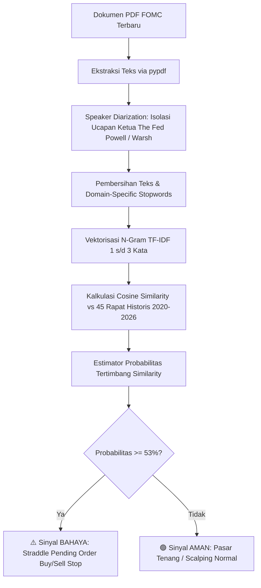

# 🏛️ FOMC NLP Tail Volatility Forecasting: XAU/USD (Gold)

[](https://www.python.org/downloads/)
[](https://opensource.org/licenses/MIT)
[](https://finance.yahoo.com/quote/GC%3DF)
[]()
[]()

> **Framework NLP kuantitatif institusional untuk memprediksi probabilitas risiko ekor volatilitas (*tail volatility risk*) ≥ 400 pips ($40.00 USD) pada instrumen Emas (XAU/USD) berdasarkan analisis transkrip konferensi pers Federal Open Market Committee (FOMC).**

---

## 📌 Daftar Isi
- [1. Latar Belakang & Tesis Kuantitatif](#1-latar-belakang--tesis-kuantitatif)
- [2. Arsitektur & Pipeline Sistem](#2-arsitektur--pipeline-sistem)
- [3. Hasil Validasi Statistik Formal](#3-hasil-validasi-statistik-formal)
- [4. Struktur Direktori](#4-struktur-direktori)
- [5. Panduan Instalasi](#5-panduan-instalasi)
- [6. Panduan Menjalankan Program & Pengambilan Data PDF](#6-panduan-menjalankan-program--pengambilan-data-pdf)
- [7. SOP Eksekusi Market (MetaTrader 4 / 5 Playbook)](#7-sop-eksekusi-market-metatrader-4--5-playbook)

---

## 1. Latar Belakang & Tesis Kuantitatif

Sebagian besar model ritel berfokus pada **prediksi arah (*directional prediction: naik vs. turun*)** saat peristiwa berita suku bunga FOMC. Pendekatan ini memiliki kelemahan mendasar:
1. **Jebakan Likuiditas (*Liquidity Sweeps / Whipsaw*)**: Algoritma institusional kerap memicu lonjakan (*spike*) ke dua arah sebelum tren terbentuk, menyapu *Stop Loss* ritel.
2. **Keterlambatan Reaksi NLP**: Reaksi arah pasar ditentukan oleh ekspektasi konsensus pasar (*priced-in*), bukan sekadar kata positif/negatif.

### 💡 Solusi: Estimasi Probabilitas Volatilitas Ekstrem
Alih-alih menebak arah, sistem ini mengestimasi **besaran energi pergerakan (volatilitas absolut)**:

```text
Volatilitas (Pips) = (High_FOMC - Low_FOMC) × 10
```

* **Target Biner**: `Y = 1` jika rentang ≥ 400 pips ($40.00 USD), dan `Y = 0` jika pergerakan normal (< 400 pips).
* **Eksekusi Asimetris**: Ketika probabilitas volatilitas tinggi (≥ 53%), posisi dieksekusi menggunakan strategi **Straddle Pending Order (*Buy Stop & Sell Stop*)** sehingga arah mana pun yang meledak akan menghasilkan keuntungan terukur.

---

## 2. Arsitektur & Pipeline Sistem



---

## 3. Hasil Validasi Statistik Formal

Pengujian dilakukan secara ketat pada data *out-of-sample* (2025–2026) tanpa bias melihat masa depan (*look-ahead bias*):

| Metrik Evaluasi | Nilai | Penjelasan Kuantitatif |
| :--- | :---: | :--- |
| **Akurasi Klasifikasi Biner** | **70.0%** | Tingkat ketepatan identifikasi kondisi pasar ekstrem. |
| **Brier Score** | **0.2142** | Tingkat kalibrasi probabilitas model terhadap realita pasar. |
| **ROC-AUC Score** | **0.571** | Kemampuan diskriminasi awal antara kondisi normal vs ekstrem. |
| **Ambang Batas Keputusan (*Threshold*)** | **0.53 (53%)** | Titik potong optimal untuk memicu sinyal volatilitas ekstrem. |

---

## 4. Struktur Direktori

```text
├── dataset/                         # 45 file transkrip historis FOMC (2020 - 2026)
├── transcript/                      # Berkas PDF resmi The Fed tahun 2026 (termasuk era Kevin Warsh)
├── fomc_gold_volatility_model.ipynb # Jupyter Notebook riset lengkap (visualisasi & uji statistik)
├── gold_prices_cache.csv            # Cache harga riil Emas COMEX (GC=F) harian
├── predict_fomc.py                  # Skrip otomatis pembaca PDF & estimator sinyal volatilitas
├── predict_fomc.bat                 # Launcher 1-klik untuk Windows
├── requirements.txt                 # Daftar dependensi Python
├── LICENSE                          # Lisensi open-source MIT
└── README.md                        # Dokumentasi resmi repositori
```

---

## 5. Panduan Instalasi

### Prasyarat
* Sistem Operasi: Windows 10/11, Linux, atau macOS.
* Python: Versi 3.9 atau lebih baru.
* Git telah terpasang di komputer Anda.

### Langkah-Langkah Instalasi:

1. **Clone Repositori**:
   ```bash
   git clone https://github.com/pranataa-labs/fomc-gold-tail-volatility-nlp.git
   cd fomc
   ```

2. **(Opsional tetapi Disarankan) Buat Virtual Environment**:
   ```bash
   python -m venv venv
   # Di Windows:
   .\venv\Scripts\activate
   # Di Linux / macOS:
   source venv/bin/activate
   ```

3. **Install Dependensi**:
   ```bash
   pip install -r requirements.txt
   ```

---

## 6. Panduan Menjalankan Program & Pengambilan Data PDF

### A. Detail Pengambilan Dokumen PDF FOMC Resmi
Agar model dapat memprediksi secara akurat, Anda membutuhkan dokumen rilis resmi The Fed. Berikut adalah panduan waktu rilis, jumlah halaman yang dipakai, dan tautan pengambilannya:

#### 1. Waktu Rilis Dokumen
* **Pukul 14:00 ET (01:00 / 02:00 WIB)**: The Fed merilis *FOMC Statement* (keputusan suku bunga berupa teks pendek). Pada momen ini, pasar sering bereaksi awal namun volatil semu (*fakeout*).
* **Pukul 14:30 ET (01:30 / 02:30 WIB)**: **Ketua The Fed (Chair) resmi muncul di podium konferensi pers**. Tepat saat Ketua The Fed mulai berbicara, dokumen teks pidato pembuka (*Chair's Opening Remarks*) dirilis ke publik di situs web The Fed.

#### 2. Berapa Halaman yang Digunakan? (3 Halaman Depan vs Dokumen Penuh)
* **Untuk Live Trading Cepat (Real-Time)**:
  * Anda **HANYA MEMBUTUHKAN 3–4 HALAMAN DEPAN (*Opening Remarks*)** yang rilis tepat saat Ketua The Fed muncul di podium!
  * **Alasannya**: Inti arah suku bunga, pernyataan inflasi, dan nada kebijakan moneter (*Hawkish/Dovish*) semuanya sudah dibacakan secara lengkap pada 3–4 halaman pembuka tersebut.
  * Anda **TIDAK PERLU** menunggu seluruh sesi tanya-jawab selesai (yang memakan waktu 45 menit hingga 1 jam).
* **Bagaimana Jika Memasukkan File Lengkap (15+ Halaman)?**:
  * Sistem tetap dapat memprosesnya dengan sempurna. Skrip telah dilengkapi *Speaker Diarization* otomatis yang menyaring hanya ucapan Ketua The Fed dan membuang pertanyaan jurnalis/moderator.

#### 3. Tautan Resmi Pengunduhan File PDF
Dokumen PDF dapat diunduh langsung dari dua kanal resmi Federal Reserve berikut:
* **Kanal Kalender Rapat FOMC**:  
  👉 [Federal Reserve FOMC Calendars](https://www.federalreserve.gov/monetarypolicy/fomccalendars.htm)  
  *(Cari baris tahun dan tanggal rapat FOMC terbaru → lihat kolom **Press Conference** → klik tautan **PDF** pada bagian **Opening Remarks** atau **Transcript**).*
* **Kanal Siaran Pers Terkini (*Recent Postings*)**:  
  👉 [Federal Reserve Recent Postings](https://www.federalreserve.gov/recentpostings.htm)  
  *(Tepat pada pukul 14:30 ET, siaran dokumen pidato Ketua The Fed akan langsung muncul di baris paling atas halaman ini).*

#### 4. Penempatan File
* Unduh berkas PDF tersebut (nama bawaan berkas dari The Fed bisa berupa `warshYYYYMMDDa.pdf`, `FOMCpresconfYYYYMMDD.pdf`, atau sejenisnya — **Anda TIDAK PERLU mengubah nama filenya**).
* Cukup simpan / letakkan berkas PDF hasil unduhan langsung ke dalam folder:
  ```text
  transcript/
  ```
  *(Program secara cerdas otomatis mendeteksi berkas PDF yang paling baru diunduh berdasarkan stempel waktu berkas).*

---

### B. Menjalankan Model

#### Cara 1: Eksekusi 1-Klik (Windows) — *Sangat Cepat & Praktis*
1. Pastikan file PDF terbaru sudah ada di folder `transcript/`.
2. **Klik 2 kali (Double-Click)** file **`predict_fomc.bat`**.
3. Sistem secara otomatis:
   * Mengambil file PDF tanggal terbaru di folder `transcript/`.
   * Mendeteksi figur Ketua The Fed yang berbicara (Jerome Powell atau Kevin Warsh).
   * Mengekstrak ucapan Ketua The Fed dan menghitung probabilitas volatilitas ekstrem.
   * Menampilkan sinyal rekomendasi trading di layar dalam tempo ~2 detik.

#### Cara 2: Menjalankan via Terminal / CLI
```bash
python predict_fomc.py
```

#### Cara 3: Membuka Notebook Riset Interaktif
```bash
jupyter notebook fomc_gold_volatility_model.ipynb
```

---

## 7. SOP Eksekusi Market (MetaTrader 4 / 5 Playbook)

Saat konferensi pers FOMC berlangsung, model akan memunculkan salah satu dari dua kondisi:

### 🔴 KONDISI A: Sinyal BAHAYA (Probabilitas ≥ 53%)
* **Karakter Pasar**: Pidato bernada agresif/kejutan moneter (*Hawkish/Dovish ekstrim*). Emas berpotensi meledak ≥ 400 s/d 1.000+ pips ($40.00 - $100.00 USD).
* **Langkah Eksekusi di MetaTrader**:
  1. **JANGAN melakukan Instant Order / Market Execution!** (Risiko *slippage* dan tersapu *spread widening* sangat besar).
  2. Buka menu **New Order** → pilih tipe **Pending Order**.
  3. Pasang strategi **Straddle**:
     * **Buy Stop**: 20 - 30 pips di atas harga *running* saat ini.
     * **Sell Stop**: 20 - 30 pips di bawah harga *running* saat ini.
  4. Pasang **Stop Loss (SL)** minimal 150 - 200 pips dari titik entry order.
  5. Gunakan **Lot Konservatif** (0.5% - 1% risiko ekuitas per posisi).
  6. Ketika salah satu order tersentuh (*triggered*), segera batalkan (*delete*) pending order sisi sebaliknya.

### 🟢 KONDISI B: Sinyal AMAN (Probabilitas < 53%)
* **Karakter Pasar**: Pernyataan The Fed bersifat rutin/pengulangan tanpa sentimen baru. Volatilitas cenderung normal (< 400 pips).
* **Langkah Eksekusi di MetaTrader**:
  1. Hindari mengejar lonjakan sesaat (*No FOMO*); lonjakan harga saat sinyal aman umumnya hanya *fakeout / stop-hunt*.
  2. Tunggu candle 15–30 menit pertama menutup untuk konfirmasi arah.
  3. Ambil target Take Profit (TP) realistis (20 - 40 pips).

---

*Disclaimer: Model ini ditujukan untuk riset kuantitatif dan analisis risiko volatilitas moneter. Trading derivatif seperti Emas (XAU/USD) memiliki risiko kerugian modal yang signifikan. Selalu terapkan manajemen risiko yang ketat.*
